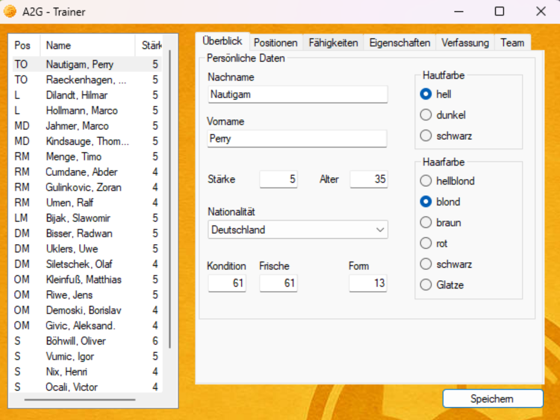
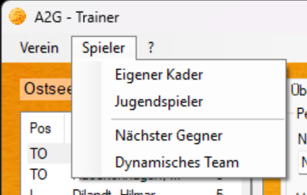
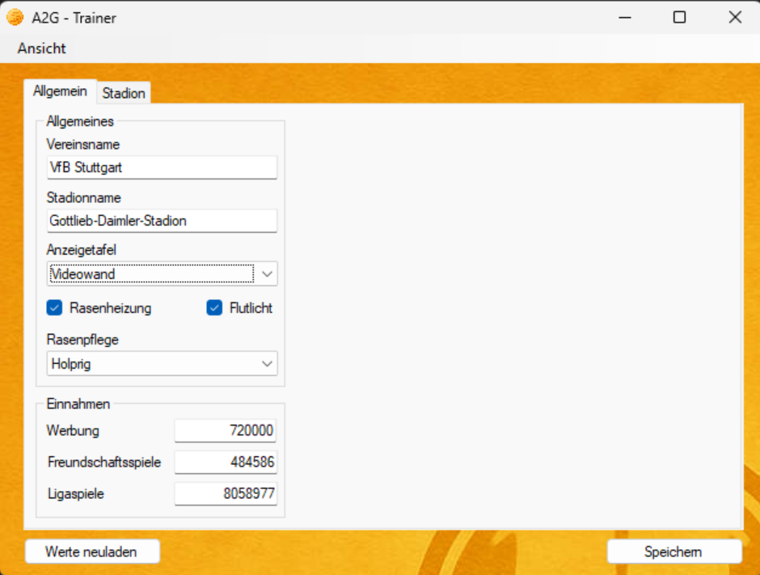
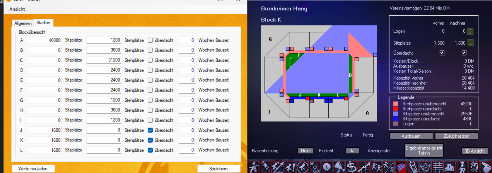
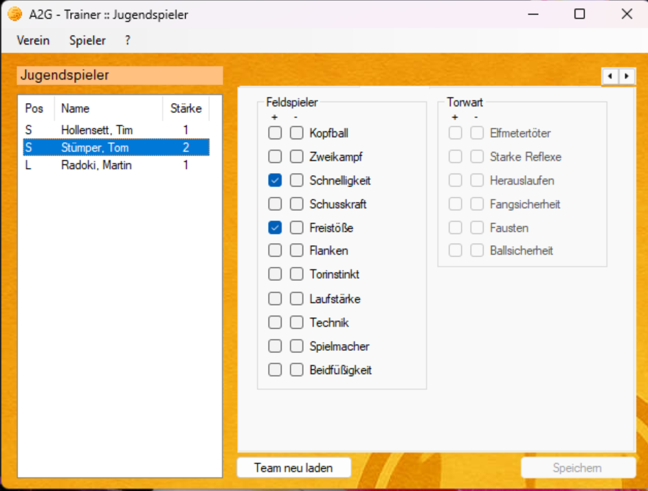
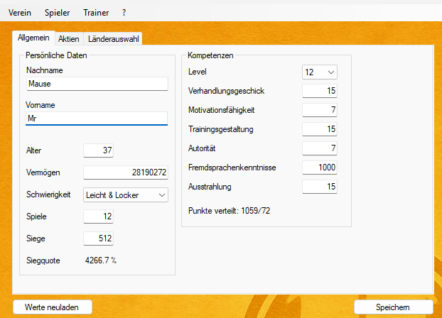

<div align="center">


# A2G-Trainer

A trainer for **Anstoss 2 Gold**, tested and compatible with the original CD release, the GOG version and the 2007 CD release. A single exe covers all three: the trainer recognises which one is running.
Built specifically to run even on legacy systems. Tested working from **Windows XP SP3 x86** onwards, including all Windows OS versions until **Windows 11 x64**.

  [](https://github.com/transfairs/A2G-Trainer/releases/latest)

[](https://github.com/transfairs/A2G-Trainer/releases/latest/download/A2G-Trainer-XP-Latest.zip)
[](https://transfairs.github.io/A2G-Trainer/)

</div>

## 📸 Screenshots
<div align="center">
<table>
<tr>
<td align="center" width="33%"><br><sub><b>Main view</b> — squad list &amp; player details</sub></td>
<td align="center" width="33%"><br><sub><b>Team choice</b> — own squad, next opponent, dynamic team</sub></td>
<td align="center" width="33%"><br><sub><b>Club view</b> — finances &amp; stadium block overview</sub></td>
</tr>
<tr>
<td align="center" width="33%"><br><sub><b>Stadium editor</b> — seats, roof, construction time</sub></td>
<td align="center" width="33%"><br><sub><b>Youth players</b> — skills editor (Jugendspieler)</sub></td>
<td align="center" width="33%"><br><sub><b>Coach view</b> — competencies &amp; difficulty</sub></td>
</tr>
</table>
</div>

## 🛠 Features
- ✅ Live memory editing of *Anstoss 2 Gold*
- ✅ **Edit all players** and **amateurs** of **any club**
- ✅ Edit player attributes, positions and skills
- ✅ Supports multiplexed bitfields (skills etc.)
- ✅ **Edit your youth players (Jugendspieler)**
- ✅ **Player renames persist permanently**, in any length up to 9 (first name) / 15 (last name) characters (see Tips below)
- ✅ **Contract, injury and suspension values persist** in the savegame: contract term, injury days and type, injury-prone, banned matches, doping, yellow cards
- ✅ Runs on **Windows XP** (built against `.NET Framework 4.0`)
- ✅ **Resizable window**: drag it larger or maximize it, and all content (fields, lists, fonts, help) grows with it
- ✅ **Club editing** (name, finances, stadium details)  
- ✅ **Stadium editor** with up to 2 × 32,767 seats per block  
- ✅ **Freeze condition & freshness** in the Team tab so they stay fixed while you play  
- ✅ **Multi-trainer (hot-seat) support**
- ✅ **Coach editing** (level, age, difficulty, and stocks)
- ✅ **Coach contract**: salary and bonuses, season goal, extras, release clause, and a club for next season that the game's season change actually accepts
- ✅ **Request a job offer** from any club of the main or a bonus country; the game makes it at the next Tagesabschluss
- ✅ **Switch bonus countries on and off** during a career (up to 4 besides the main country)  
- ✅ **Automatic reconnect & turn-handoff detection:** It detects a game restart, a different savegame being loaded, or a hot-seat turn passing
- ✅ **Help section** integrated into the UI, also available as the [online Projektseite](https://transfairs.github.io/A2G-Trainer/)  
- ✅ Clean WinForms UI with tabbed views and menu navigation
- ✅ Modular MVC architecture
- ✅ Portable version

## 🧩 Dependencies

**To run the trainer**
- On **Windows XP**, make sure [.NET Framework 4.0](https://www.microsoft.com/en-us/download/details.aspx?id=17718) is installed.  
- On **Windows 11**, no additional installation is necessary.  

**To build/test from source**
- **Visual Studio 2019+** (Community is fine) with the **.NET desktop development** workload, *or* the standalone [Build Tools for Visual Studio](https://visualstudio.microsoft.com/downloads/#build-tools-for-visual-studio-2022) with the same workload. Either gives you the full MSBuild toolchain this project needs. See the note in **Testing** below on why the plain `dotnet` SDK CLI can't build it end-to-end.
- The [.NET SDK](https://dotnet.microsoft.com/download) (8.0 or newer). Used to run already-built tests and to drive the `dotnet test`/coverage commands below. CI uses 8.0.x.
- No manual **.NET Framework 4.0 Developer/Targeting Pack** install is needed for the main project. `Microsoft.NETFramework.ReferenceAssemblies` supplies those via NuGet automatically on restore.
- The **A2G-Trainer-XP.Tests** project targets **.NET Framework 4.7.2**, which needs that version's Reference Assemblies installed which are included by the "`.NET desktop development`" VS workload above, so no extra step if you have that.

## 🚀 Run Instructions
1. Launch `A2G-Trainer-XP.exe` and start **Anstoss 2 Gold**; either order works.  
2. Load your savegame. The tool detects the game automatically and reconnects on its own after a game restart or when you load a different savegame.  
3. Use the **Tool Strip** to switch to the club view (finances, stadium, etc.) or edit other teams.

## 💡 Tips & Hints
- To assign a **negative number of seats** to a stadium block, enter any value **greater than 32,767**.  
- After editing a stadium block, **Block A is automatically set to one week construction time** to ensure all changes are persisted.  
- A player rename survives a save/reload in any length up to 9/15 characters: a name the savegame already has is reused, a new one is added the way the game adds names, and other players with the old name keep it. Only on a version whose addresses the trainer can't confirm does the old rule apply (the new name must already exist in the savegame, or have **exactly as many characters** as the old one); otherwise the name only lasts until the next Tagesabschluss/load and you get a warning naming the player. Details land in `%LocalAppData%\A2G-Trainer-XP\trainer.log`.  
- On the **GOG version** (and the 2007 CD release), the trainer checks where the permanently saved player data lives the first time it loads your own team. If it can't find it, it falls back to the in-memory display values as before: Jugendspieler then can't be changed permanently, and renames only last until the next load. The result is logged to `%LocalAppData%\A2G-Trainer-XP\trainer.log`; please attach it when reporting a problem.  

## 🔧 Build Instructions
1. Open the solution in **Visual Studio 2019**  
2. Ensure the target framework is **.NET Framework 4.0**  
3. Build the project (`Release|x86` recommended for XP). There's no separate configuration per game release: the trainer identifies the game build itself (from the main module's PE header, see `Controller/GameBuild.cs`), so the one build handles the original, GOG and 2007 CD releases.  
4. Optional: run the test suite (see **Testing** below) to verify core logic before building a release  
5. Building from the CLI instead of Visual Studio? See the note under **Testing**. A plain `dotnet build` fails on this project, use `msbuild` as shown there.  

## 🧱 Project layout
This trainer shares its foundation with the [A3-Trainer](https://github.com/transfairs/A3-Trainer) for *Anstoss 3* instead of keeping two copies of it:

- **`Shared/`** is a git submodule pointing at [Anstoss-Trainer-Shared](https://github.com/transfairs/Anstoss-Trainer-Shared). It holds a Visual Studio *shared project* (`AnstossTrainer.Shared.projitems`: process memory access, logger, main-window base `TrainerShell`, view base `TrainerView`, game observer loop `GameObserver`, view scaler) whose code is compiled into each trainer, so every trainer stays a single exe. It also holds the app manifest, the STA test helper, the online help's stylesheet and script (copied next to `help/` on deploy) and the changelog scripts used by the release workflow.
- Clone with submodules: `git clone --recursive https://github.com/transfairs/A2G-Trainer.git` (or run `git submodule update --init` in an existing clone).
- Game-specific additions to shared classes live in the trainer as `partial` parts, e.g. `Controller/ProcessMemory.A2.cs` (build and persistent layout) and `Controller/Logger.A2.cs` (log folder, debug switch).
- **Shared changes arrive automatically:** the Shared repository's CI builds and tests both trainers with every change. After a green push to its master, [`shared-update.yml`](.github/workflows/shared-update.yml) moves `Shared/` to the new commit, runs this trainer's tests and commits the update to master (or opens a pull request if the tests fail). It also runs daily and can be started by hand.

## 🧪 Testing
The **A2G-Trainer-XP.Tests** project (xUnit) covers the memory-reading/writing logic and, for the WinForms views, the actual controls. None of it needs the game running.

**Visual Studio**
- `Test` → `Test Explorer`, then **Run All Tests**.
- Coverage: Enterprise has `Test` → `Analyze Code Coverage for All Tests` built in. On Community/Professional, install the free **Fine Code Coverage** extension, or use the CLI steps below.

**VS Code**
- Install the **C# Dev Kit** extension, then use the **Testing** panel (flask icon) to discover and run tests.
- Coverage: run the CLI steps below, then install **Coverage Gutters** to show results inline in the editor.

**CLI**

Plain `dotnet build`/`dotnet test` **fails outright** on this project (`MSB3822`/`MSB3823`, about `Trainer.resx`'s binary resources needing `System.Resources.Extensions`), because the dotnet SDK's own MSBuild handles this legacy .NET Framework 4.0 project's resources differently than full Visual Studio MSBuild does. Build with `msbuild` first, then run the already-built tests with `dotnet test --no-build` (this is exactly what [`.github/workflows/release.yml`](.github/workflows/release.yml) does in CI):
```bash
msbuild A2G-Trainer-XP.Tests/A2G-Trainer-XP.Tests.csproj /t:Restore,Build /p:Configuration=Debug
dotnet test A2G-Trainer-XP.Tests/A2G-Trainer-XP.Tests.csproj --no-build --no-restore
```
For coverage, add the collector once and pass the same flag to that build:
```bash
dotnet add A2G-Trainer-XP.Tests package coverlet.collector
msbuild A2G-Trainer-XP.Tests/A2G-Trainer-XP.Tests.csproj /t:Restore,Build /p:Configuration=Debug
dotnet test A2G-Trainer-XP.Tests/A2G-Trainer-XP.Tests.csproj --no-build --no-restore --collect:"XPlat Code Coverage"

# turn the raw XML into a browsable report (one-time tool install)
dotnet tool install -g dotnet-reportgenerator-globaltool
reportgenerator -reports:"A2G-Trainer-XP.Tests/TestResults/**/coverage.cobertura.xml" -targetdir:coveragereport -reporttypes:Html
```
Open `coveragereport/index.html` for a per-file/method/line breakdown.

> `msbuild` here means the **full Visual Studio MSBuild**, not the one bundled with the dotnet SDK; make sure the one on your `PATH` resolves there (a "Developer Command Prompt for VS" or a machine with only VS installed gets this right automatically; run `where msbuild` if unsure).

> A handful of tests self-attach to the running test process to exercise real memory reads/writes safely, without a live game - this needs the test host running as **x86** (already set up in the project). The WinForms-view tests additionally spin up real controls on a background STA thread.

Visual Studio's and VS Code's test runners build the project their own way and don't hit this issue. The CLI workaround above is only needed when driving the build from a terminal.

## Extras
Included in this repository is an updated **Cheat Engine table** originally created by [strajk-](https://www.anstoss-juenger.de/index.php/topic,4619.0.html) for the original version of *Anstoss 2 Gold*. Each release also ships a GOG-addressed variant of the same table (`*-GOG.ct`), generated automatically from the original by [scripts/Convert-CtToGog.ps1](scripts/Convert-CtToGog.ps1).

## Credits
Thanks to the [anstoss-juenger.de](https://www.anstoss-juenger.de/index.php/topic,6260.0.html) community, especially **strajk-**. Some code fragments and ideas were taken from his [A2G-RTE project](https://github.com/strajk-/A2G-RTE). Many thanks to **22** for his efforts and assistance in finding any detail of the game in the memory.

## 🛡 Disclaimer
This tool directly accesses game memory. Use at your own risk.  
This project is **not affiliated** with **Ascaron** or the developers of *Anstoss 2 Gold*.
